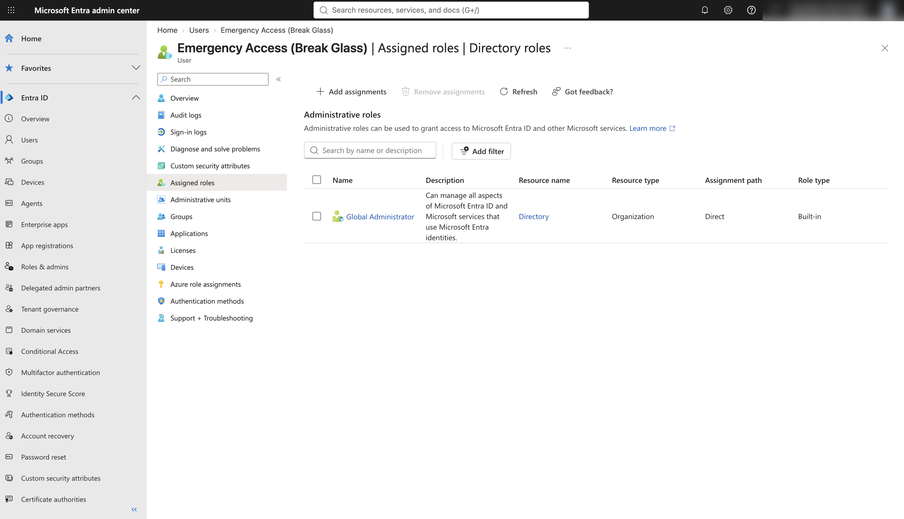

# Phase 1: Identity and enrollment

**Exam domain:** Prepare infrastructure for devices (20-25% of MD-102)

**Goal:** prepare the tenant so devices can enroll: users, groups, admin roles, enrollment settings, Windows Hello for Business and a Windows Autopilot profile.

## Progress

- [x] A. Tenant basics: organization name, break-glass account, company branding
- [ ] B. Users, dynamic groups, group-based licensing (in progress)
- [ ] C. Admin roles: scope tags, custom Intune role
- [ ] D. Entra device settings
- [ ] E. Enrollment: automatic enrollment, restrictions, Enrollment Status Page
- [ ] F. Windows Hello for Business
- [ ] G. Autopilot deployment profile and device registration

## Block A: Tenant basics

- **Organization name** set to Northshore Health Clinic. Microsoft stores the name separately for each billing account and for the Entra tenant; the tenant name is changed in Entra ID > Overview > Properties.
- **Emergency access (break-glass) account** with a permanent, active Global Administrator role. Cloud-only, long password stored offline, to be excluded from every Conditional Access policy in Phase 3. Active rather than PIM-eligible, because PIM activation could be what's broken in an emergency.
- **Company branding** (Entra ID > Custom branding): logo, sign-in background and an "authorized staff only" message on the sign-in page.

## Block B: Users and groups

### Users

10 fictional staff: 2 created in the portal to learn the interface, 8 created with [`scripts/New-LabUsers.ps1`](scripts/New-LabUsers.ps1) from [`scripts/users.csv`](scripts/users.csv).

Every user has **Department** set (it drives the dynamic groups) and **Usage location** set (required before a licence can be assigned).

### Groups

| Group | Type | Rule / members |
| --- | --- | --- |
| `GRP-Clinical-Users` | Dynamic user | `(user.department -eq "Clinical")` |
| `GRP-Reception-Users` | Dynamic user | `(user.department -eq "Reception")` |
| `GRP-IT-Users` | Dynamic user | `(user.department -eq "IT")` |
| `GRP-All-Staff` | Dynamic user | `(user.department -in ["Clinical","Reception","IT"])`. Uses departments so admin and break-glass accounts stay out |
| `GRP-Pilot-Users` | Assigned | 2 users for testing changes first |

### Licensing

Enterprise Mobility + Security E5 is assigned to `GRP-All-Staff` with **group-based licensing**, so new staff are licensed automatically when their department is set.

## Running the script

Requires PowerShell 7 and the Microsoft Graph modules:

```powershell
cd phase-1-identity/scripts
Install-PSResource Microsoft.Graph.Authentication, Microsoft.Graph.Users -Scope CurrentUser -TrustRepository
./New-LabUsers.ps1                      # create users from users.csv
./New-LabUsers.ps1 -CsvPath ./test.csv  # test with a smaller file first
```

## Break/fix log

**Homebrew couldn't install PowerShell.** `brew install --cask powershell` failed with `No Cask with this name exists` because the cask has been retired. `brew install powershell` (the formula) worked. Microsoft's signed .pkg would have been the other option.

**`Install-Module` couldn't find the Graph modules.** The PowerShell Gallery wasn't registered in this PowerShell build. Fix: register the repository and use PSResourceGet (`Install-PSResource`). _Update once confirmed_

## Screenshots

Break-glass account with Global Administrator assigned directly (not through PIM):



Branded sign-in page:


