# Identity and enrollment

This covers the "Prepare infrastructure for devices" part of MD-102: getting the tenant ready so devices can enroll.

## Tenant basics

I set the organization name to Northshore Health Clinic. Microsoft keeps the name separately for each billing account and for the Entra tenant, so the tenant name has to be changed in Entra ID > Overview > Properties.

I created a break-glass account with Global Administrator assigned permanently and active, not PIM-eligible, since PIM activation could be the thing that's broken in an emergency. It's cloud-only, the password is long and kept offline.


I also set up company branding (Entra ID > Custom branding) with a logo, a sign-in background and an "authorized staff only" message.

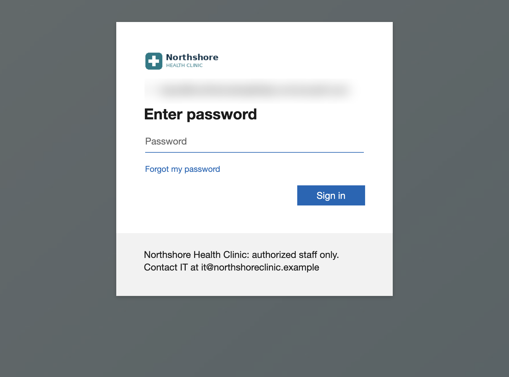

## Users and groups

There are 10 fictional staff. I created 2 in the portal to learn the interface and the other 8 with [New-LabUsers.ps1](scripts/New-LabUsers.ps1) from [users.csv](scripts/users.csv). Every user has a department, which the dynamic groups use, and a usage location, which is needed before a licence can be assigned.

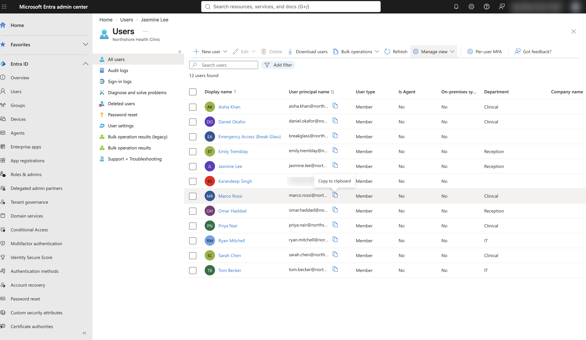

The groups:

- `GRP-Clinical-Users`, `GRP-Reception-Users` and `GRP-IT-Users` are dynamic, one per department, e.g. `(user.department -eq "Clinical")`
- `GRP-All-Staff` is dynamic with `(user.department -in ["Clinical","Reception","IT"])`. Matching on department keeps admin and break-glass accounts out of it.
- `GRP-Pilot-Users` is assigned, with 2 users for trying changes out first

Two of the dynamic groups sat at 0 members for a while after I created them. The rules were fine, the processing status just said "Not started", and they filled in on their own later.

EMS E5 is assigned to `GRP-All-Staff` through group-based licensing, so a new staff member gets licensed as soon as their department is set. Group licences can only be added in the Microsoft 365 admin center now, Entra just shows them. I didn't assign Intune separately because EMS E5 already includes it.

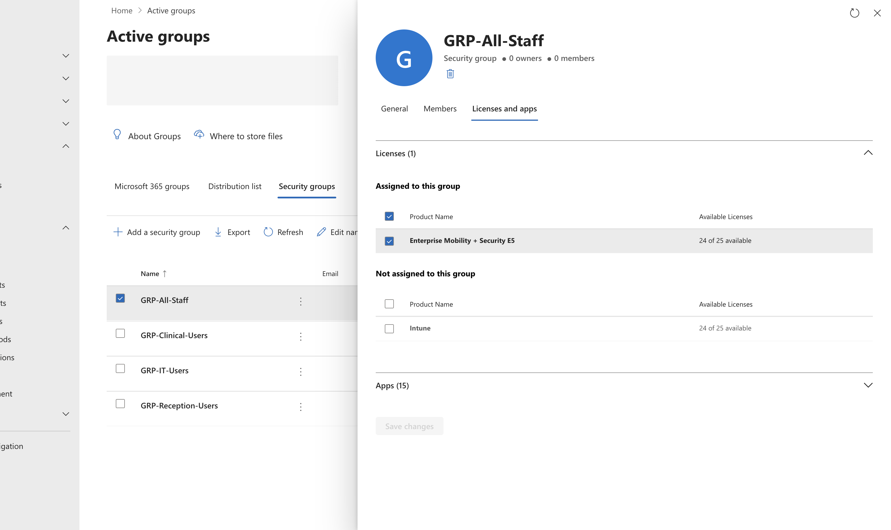

To run the script you need PowerShell 7 and the Graph modules:

```powershell
cd phase-1-identity/scripts
Install-PSResource Microsoft.Graph.Authentication, Microsoft.Graph.Users -Scope CurrentUser -TrustRepository
./New-LabUsers.ps1
```

## Admin roles

Entra roles apply to the whole tenant, while Intune roles can be limited to certain devices with scope tags.

Tom Becker (IT Administrator) is eligible for the Intune Administrator role through PIM, so he has to activate it when he needs it instead of having it all the time.

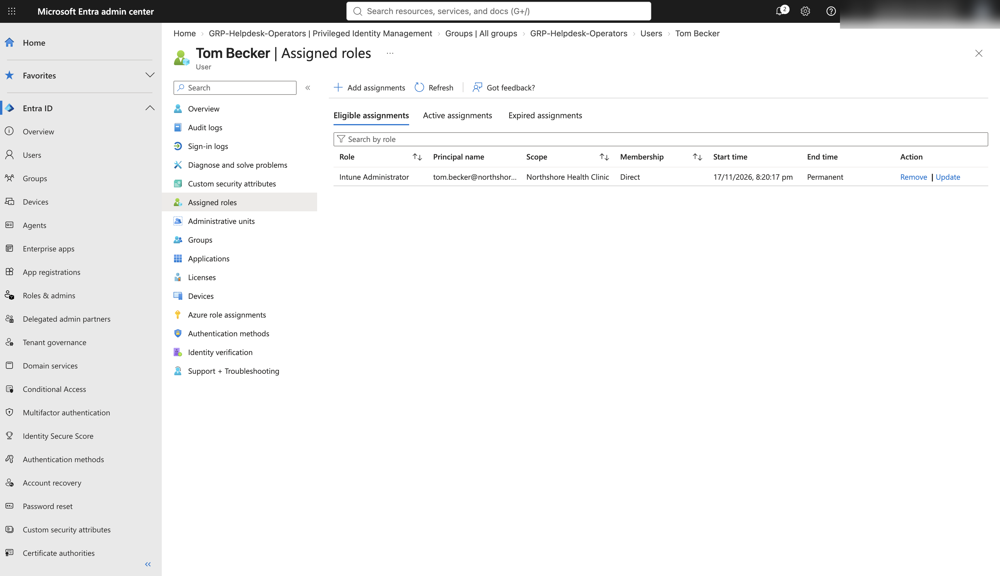

For the help desk I made a custom Intune role called Helpdesk Operator. It can read devices and run sync, reboot, retire and wipe, but it can't change any policies.

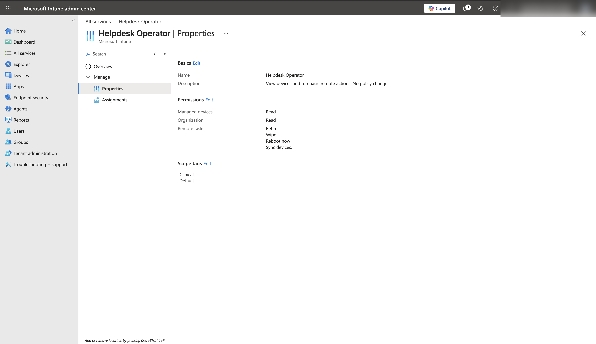

The role is assigned to `GRP-Helpdesk-Operators` (Ryan Mitchell). The assignment uses `GRP-Clinical-Users` as the scope group, so Ryan can only act on clinical staff's devices, and the `Clinical` scope tag, so he only sees objects tagged Clinical.

The way I think about it: the role is what he can do, the admin group is who gets it, the scope group is whose devices, and the scope tag is which objects he can see.

When I signed in as Ryan, Tenant administration gave a "You don't have access" error, which is what I wanted.

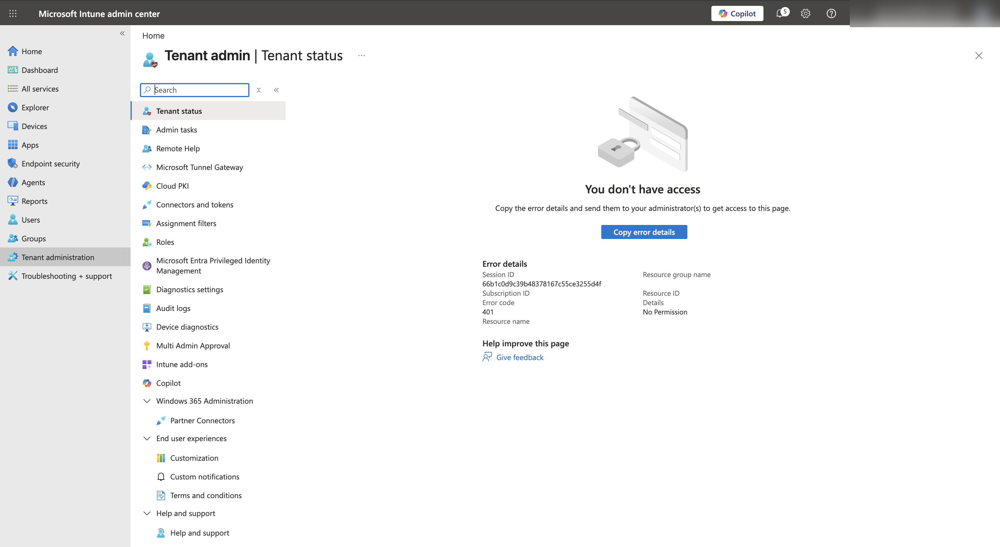

## Entra device settings

These are tenant-wide and mostly apply when a device joins (Entra ID > Devices > Device settings):

- Users can join and register devices (needed for Autopilot and personal devices)
- MFA to join is off here; Microsoft recommends enforcing it with Conditional Access instead
- Max 20 devices per user
- Users aren't made local admins when they join a device, so staff stay standard users
- Microsoft Entra LAPS is on
- Users can't look up their own BitLocker recovery keys

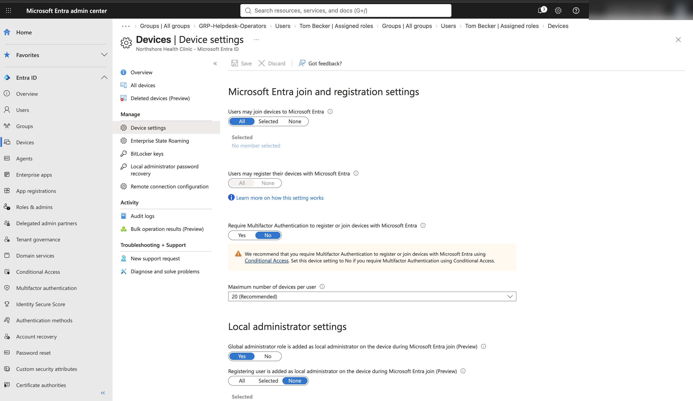

I skipped Enterprise State Roaming because its settings moved to Windows settings backup and restore in May 2026.

## Enrollment

### Device groups

I made two dynamic device groups:

- `GRP-Autopilot-Devices` picks up every Autopilot device: `(device.devicePhysicalIds -any (_ -startsWith "[ZTDId]"))`
- `GRP-Clinical-Devices` picks up Autopilot devices with the group tag Clinical: `(device.devicePhysicalIds -any (_ -eq "[OrderID]:Clinical"))`

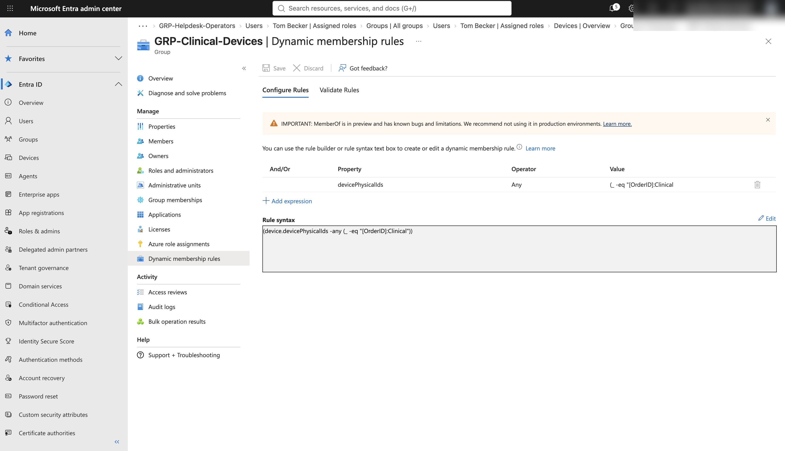

The `Clinical` scope tag is assigned to `GRP-Clinical-Devices`, so clinical devices get tagged automatically and show up for the help desk role.

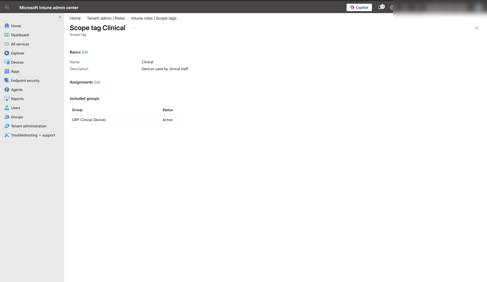

### Automatic enrollment

MDM user scope is set to `GRP-All-Staff`, so staff devices enroll in Intune when they join Entra ID. The WIP user scope is left at None because Windows Information Protection is being retired.

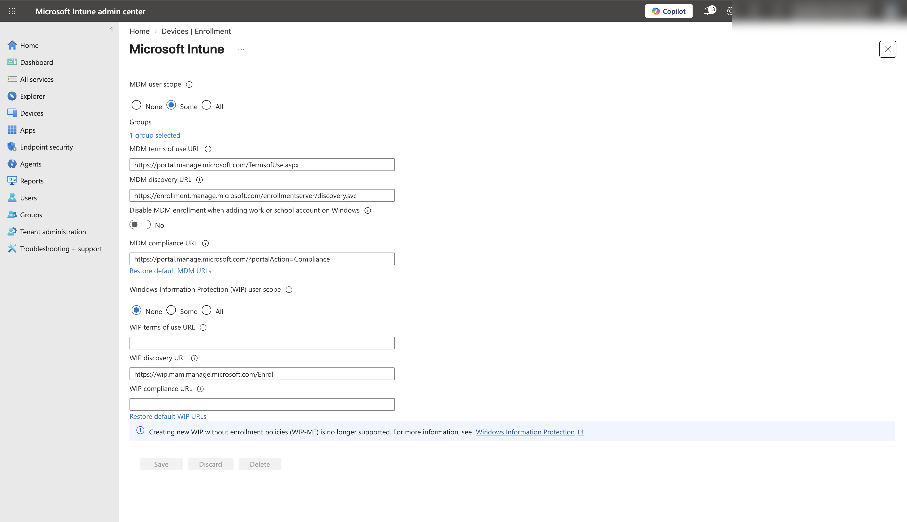

### Enrollment restrictions

- **Windows - Corporate only** (priority 1, assigned to `GRP-All-Staff`) blocks personally owned Windows devices
- The default device limit is 5 per user
- **Pilot - 1 device** limits `GRP-Pilot-Users` to 1 device

When a user is in more than one restriction, the one with the higher priority wins, and the default always comes last.

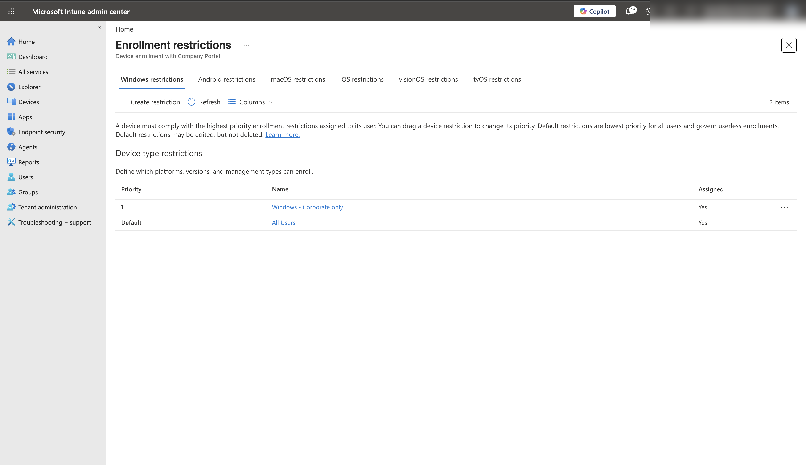

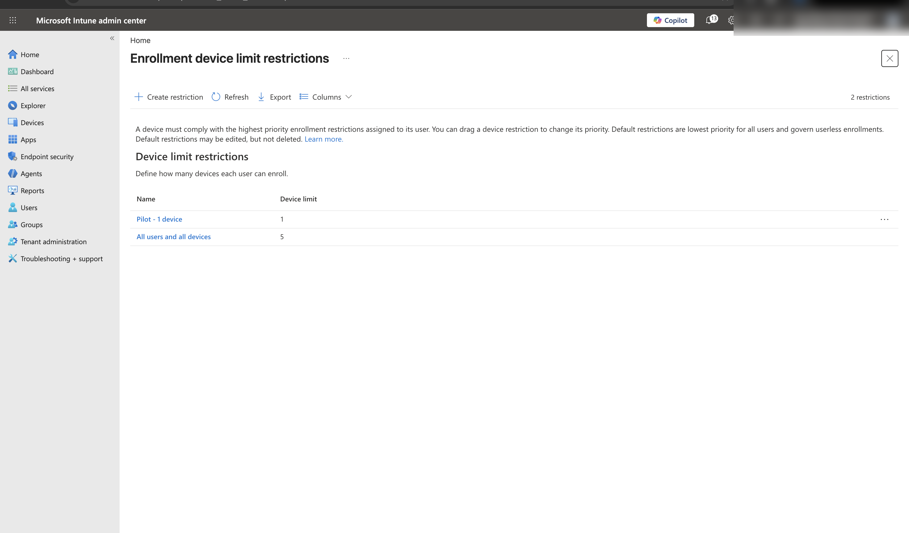

### Enrollment Status Page

`ESP - Clinic devices` is assigned to `GRP-Autopilot-Devices`. It shows setup progress and blocks the device until all apps and profiles are installed, so staff don't get to the desktop on a half-configured device. If something fails, the user sees "Setup didn't finish. Please contact Northshore IT." and can either reset the device or continue. Log collection is on so the user can save logs for IT.

I left Windows updates on during setup. It's slower on the VM but closer to how a real clinic would set it up.

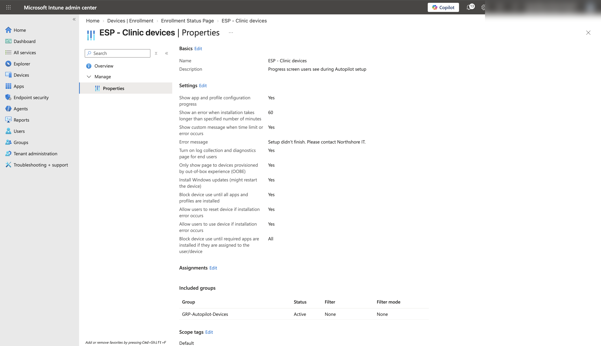

### Company Portal

Company Portal uses the clinic name, logo and teal theme colour, with Northshore IT as the support contact. The remove and reset buttons are hidden on corporate Windows devices so staff can't unenroll or wipe a clinic laptop themselves.

The privacy statement URL is a required field. The clinic doesn't have a real privacy page, so I used Microsoft's.

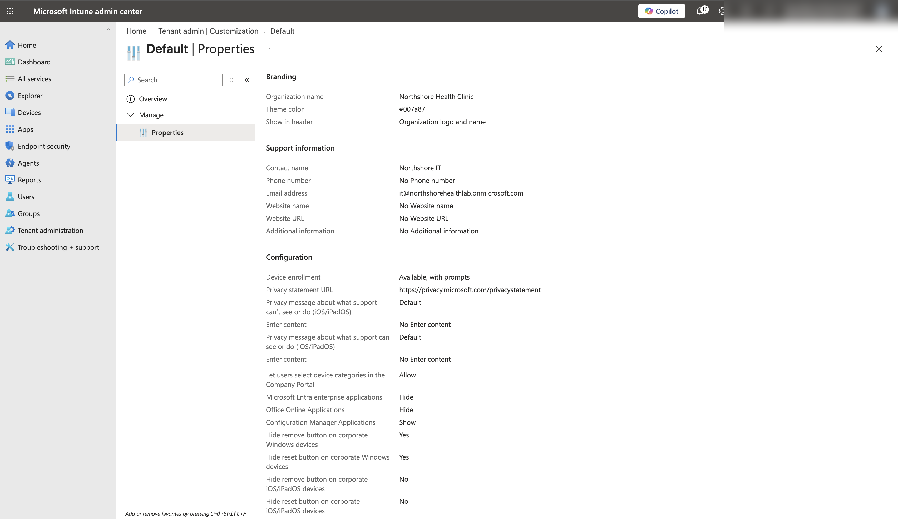
